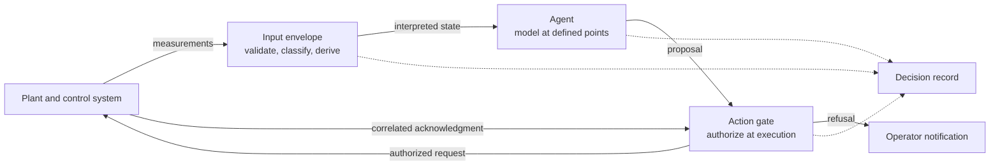

# Deterministic industrial agents

Industrial buyers increasingly ask for "deterministic" AI agents. A hosted language model should not be assumed to meet the strict form of that request, and an industrial agent does not need it to. This page sets out where determinism can and should be engineered in an agent system: in the goal the system is judged against, in the inputs it reasons over, in the authorization of every action, and in the record that allows a decision to be rebuilt.

It is written for automation, control and operational technology engineers, and for architects evaluating agent systems. It describes a proposed architecture and the verification requirements that go with it. The worked example uses illustrative values, and nothing on this page describes the configuration of a particular plant.

The full argument, with formal definitions, the assurance protocol and references, is in the working paper [Deterministic Where It Counts: Goals, Envelopes, and Evidence for Language-Model Agents in Industrial Operations](../../research/2026.10.19_Deterministic_Where_It_Counts.pdf) (van Schalkwyk and Green, October 2026).

## 1. Three meanings of deterministic

The word is used for three different properties. They need different engineering.

| Property | Definition | Achievable with a language model in the loop |
|---|---|---|
| Reproducible output | The same complete input always gives the same output | Not to be assumed for a hosted language model; possible under controlled inference; yes for code and static validated models with their inputs captured |
| Deterministic disposition | For the same execution state, proposal and configuration, the decision to execute, refuse or escalate is the same | Yes, when the disposition is computed by deterministic checks |
| Reconstructable decision | A past decision can be rebuilt from its record and re-evaluated with the same result | Yes, when the record captures everything the checks depended on |

Formally, let $s_{\mathrm{exec}}$ be the complete state used by the authorization decision, $p$ the parsed proposal and $c$ the approved configuration and implementation version: rules, thresholds, utility functions, prompts, model identity and code. The disposition

$$
D(s_{\mathrm{exec}}, p, c) \in \{\text{execute}, \text{refuse}, \text{escalate}\}
$$

is deterministic when identical $(s_{\mathrm{exec}}, p, c)$ produce an identical result. The model may produce a different $p$ on another run. For a given $p$, with the same execution state and configuration, $D$ does not vary. State observed during planning can differ from state checked at execution, and the record must distinguish them. The authorization predicate in section 5 decides whether a request may execute; a separate, versioned routing rule decides whether a denied or unsupported proposal is refused or escalated. Escalation never authorizes a plant write.

"Identical inputs" has to include everything the result depends on: time values, external reads and message ordering as well as data values. Code that is not a language model is reproducible only when those inputs are captured.

Hosted language model services do not generally guarantee reproducible output, even at a sampling temperature of zero, because the numerical result of a request can depend on how it is batched with other traffic. Reproducible inference has been demonstrated for self-hosted models with batch-invariant kernels, at some cost in throughput. A design that needs reproducible output from a hosted model is therefore fragile. A design that needs only a deterministic disposition is not.

The draft EU GMP Annex 22 (July 2025) uses the first meaning for AI models in critical pharmaceutical manufacturing applications and excludes large language models from them. Section 10 notes how that discussion has moved since.

## 2. Where variability enters

In a governed agent system the language model is called at defined points: to interpret an observation, to reflect on what has changed and to propose a plan. The software around those calls is ordinary code, but its results depend on the information and events it receives, so reproducing them requires capturing those inputs.

This differs from frameworks in which the model drives control flow, interleaving reasoning with tool calls and deciding which action to take next and when to stop. Each model-controlled choice can vary between runs, and the resulting proposal needs checking against the plant's current conditions before it takes effect.

The useful engineering question is not how to make the model repeat itself. It is which choices can change when the model gives a different answer, and which deterministic mechanism surrounds each of them.

## 3. The objective fixes how success is judged

An agent pursues a goal. In operations the goal can be written down precisely as an objective function over measured values. Let $m_i$ be the measured value of the $i$-th measure, $u_{i,c}$ a utility function under configuration $c$ expressing how much each level of that measure is worth, and $w_i$ its weight:

$$
J_c(m) = \sum_{i} w_i \, u_{i,c}(m_i).
$$

The configuration fixes the utility functions, weights, measurement definitions and treatment of missing data. For the same measurements and configuration, $J_c$ is the same every time. The model can propose different plans. It cannot redefine success.

### 3.1 Constraints sit outside the objective

Safety and quality limits are not terms in $J_c$. Let $\mathcal{A}_0(c)$ be the set of well-formed actions defined in the configuration. The admissible actions in state $s$ are:

$$
\mathcal{A}(s, c) = \{\, a \in \mathcal{A}_0(c) : g_k(s, a, c) \le 0 \ \text{for all required } k \,\}.
$$

The objective ranks only admissible actions. Within the mathematics, a limit expressed as a utility penalty can be traded away by a large enough gain elsewhere, and a limit expressed as a constraint cannot. An action is admissible only when every required check is defined and passes on sufficiently current inputs. Missing, invalid or unevaluated checks never count as passes. This establishes permission under the encoded constraints; physical safety also depends on the correctness and coverage of those constraints and on the assumptions of their execution.

### 3.2 Measured change and its attribution

Proposals carry predicted effects, useful for choosing between options. Over an evaluation horizon $h$ agreed in advance, the measured change is:

$$
\Delta J = J_c(m_{t+h}) - J_c(m_t).
$$

$\Delta J$ describes the change. It does not by itself attribute that change to the agent's action, because disturbances and other interventions also move the measurements. Record the predicted $\widehat{\Delta J}$ beside the measured $\Delta J$ for each executed plan, record material disturbances and other interventions, and compare against a suitable baseline or controlled scenario before crediting a result to an action. Acceptance criteria may reward holding a target or preventing deterioration as well as improving the score. Never score an agent on its own prediction or its own assessment of how well it did.

### 3.3 Worked example

Assume two runs of the same agent team, given the same state and evaluated under the same controlled disturbance scenario and horizon, propose different admissible actions. Run A proposes a small reduction in a reflux rate; run B proposes a feed-rate trim. With illustrative values:

| Run | Predicted $\widehat{\Delta J}$ | Measured $\Delta J$ over $h$ | Constraint margin maintained |
|---|---|---|---|
| A | 0.040 | 0.031 | Yes |
| B | 0.025 | 0.034 | Yes |

The runs behaved differently, as two operators might, and both actions were permitted. In this illustration run B produced the larger measured improvement despite the lower prediction, which is evidence about prediction quality as well as about the choice. In an operating plant, attributing such a difference to the actions would need further evidence.

## 4. The input envelope

An agent reasoning over a failed transmitter reading can form a false view of the process, and output checks do not remove the need to validate its inputs. The input envelope validates observations and computes derived state outside the language model. The general treatment of observations as time-indexed claims is in [DataStream integration](datastream-integration.md).

### 4.1 Quality classification

Each value reaching an agent carries an explicit source state:

| State | Meaning |
|---|---|
| Live | Measured value passing its quality rules |
| Estimated | Replaced by a validated static model, such as a soft sensor, because the measurement failed |
| Held | Last good value, held for a bounded period set per measurement class |
| Stale | Older than the permitted age for its source class, whether measured, estimated or held |
| Bad | Failed quality rules, including a configured frozen-value diagnostic |
| Unknown | Insufficient information to classify |

A measurement with no approved classification rule should be treated as bad. Validity is decided from the source state, never inferred from the numeric value: a missing value coerced to zero can place a measurement in a safe band or raise a false alarm. Frozen-value detection is a configured diagnostic, not infallible fault detection. Substitution provenance is carried separately from signal quality, so that a value substituted by the control system cannot reach an agent marked as live.

### 4.2 Derived state

Limits, zones and operating mode are computed from approved tables and fixed rules and passed to the agent as interpreted state. For a valid finite measurement $x$ with approved limits $L_{\text{high}} > L_{\text{low}}$, a normalized margin is:

$$
\mu = \frac{\min(x - L_{\text{low}},\ L_{\text{high}} - x)}{L_{\text{high}} - L_{\text{low}}},
$$

which reaches at most $0.5$ inside the interval and is reported as unavailable when its inputs are invalid. Record the side and trend of the margin alongside it. Operating mode is derived by a fixed priority and reported as unknown when any required input is bad.

Where agents cannot join several message streams themselves, each agent should receive one joined observation per cycle, carrying both the interpreted state and the context fields that govern its authority: operating mode, authority state and schema version.

## 5. The action envelope

### 5.1 A bounded action vocabulary

Agents choose from a short list of engineered actions with typed parameters and enumerated or ranged values. Examples are approving or declining an operating band proposed by an existing optimizer, starting or ending a sequence that has already been validated, writing a value within a mapped range, or escalating to an operator. Escalation should always be available and never gated.

### 5.2 Authorization at execution

Each request $r$ is authorized against the execution state immediately before it is applied:

$$
\begin{aligned}
\mathrm{allow}(r, s) ={}& [r \in \mathcal{A}_0(c)] \land [\mathrm{auth}(s) = \text{act}] \land [\mathrm{age}(r) \le \tau] \\
&\land [\mathrm{target}(r) \in T] \land [\mathrm{value}(r) \in R(\mathrm{target}(r))] \\
&\land [\mathrm{lim}(r, s) = \text{pass}],
\end{aligned}
$$

where $T$ is the set of targets agents may write to, $R$ the permitted range for each target, $\tau$ the maximum request age, and $\mathrm{lim}(r, s) = \text{pass}$ exactly when every required $g_k$ is defined and satisfied on sufficiently current inputs. Any false term refuses the request, records the refusal and notifies the operator.

The authority states *advise* and *act* govern only the agents' permission to write. Some deployments call them open and closed loop, which should not be confused with the topology of the plant's control loops.

Four properties make the gate a guarantee rather than an intention:

- **Fail-safe authority.** The authority state is "act" only on an explicit, current setting made by an accountable person. Missing, stale or unreadable means "advise". A communications watchdog may return the system to "advise" on loss of contact; it must never grant "act".
- **Authoritative reads.** The gate reads the authority state from its source of record at execution time, not from a cached or broadcast copy.
- **Complete coverage.** Every check that must hold is evaluated in every relevant action path. A deterministic check that returns a verdict only to the agent is advisory, however rigorous the check itself.
- **Assessed independence.** The control system's own logic decides whether to apply a value, and safety instrumented systems and interlocks remain separate from the agents and the gate. Whether that separation is adequate, including shared infrastructure, credentials and data paths, is assessed for the deployment against functional safety requirements such as IEC 61511.

### 5.3 Approval to application

A request that waits in a buffer can outlive the conditions it was approved under. At application, control-side logic verifies that the request remains authorized and that its required state predicates still hold. Couple buffered values to their authorization with a request or sequence identifier and a defined acknowledgment protocol. Verify behavior under delayed, reordered, repeated and interrupted writes; writing a value before its enable flag is not by itself sufficient evidence of correct application.

### 5.4 Delivery and confirmation

Define retry and duplicate handling for each action, using request identity, expiry checks and control-side deduplication or idempotent semantics where appropriate. Transport delivery, command acceptance and physical application are different properties. Record publication, acceptance, application and outcome separately, and correlate application acknowledgments with the request; a read-back showing the requested value does not by itself prove that this request caused it. The broader treatment of these transitions is in [Tool orchestration](tool-orchestration.md).

## 6. Prompts and checks

Instructions in an agent's prompt are pre-filters. Narrow roles, a fixed output format, explicit rules for missing or stale data and an enumerated list of actions may make proposals more consistent and reduce how often a proposal is refused at the gate. They guarantee nothing, because a model is asked to follow an instruction and may not.

| Mechanism | Effect | Guarantee |
|---|---|---|
| Instruction in the prompt | May improve consistency of proposals | None |
| Deterministic check called by the agent | Informs the proposal | None unless also enforced in the action path |
| Deterministic check in every action path | Refuses non-compliant requests | Within the check's coverage and correctness |
| Control system logic, interlocks and safety systems | Separate protection | Subject to assessed independence |

The design rule follows: any mandatory precondition or limit for an agent action is implemented as a check in every relevant action path. The same applies to standard operating procedures. For an agent, their preconditions bind only when they are executed as checks, and the coverage and correctness of those checks still have to be tested. Measure the effect of prompt changes on invalid proposals separately from enforcement.

### 6.1 Computable policy

The design rule above is what we call computable policy. A policy is computable when it is expressed in a form software can evaluate against current state with an unambiguous result, rather than as prose for a person or a model to interpret. Deontic logic supplies the vocabulary: obligations, permissions and prohibitions, conditioned on context. A computable policy rule can be written as

$$
\pi = (\mu, \alpha, \varphi, \sigma, \kappa),
$$

where $\mu$ is the modality (obligation, permission or prohibition), $\alpha$ the class of actions it governs, $\varphi(s)$ a condition over measurable state, $\sigma$ its scope and the authority that owns it, and $\kappa$ its version. Evaluated against an execution state, each rule returns satisfied, violated or not evaluable, and not evaluable never counts as satisfied. Prohibitions and unmet obligations become required checks $g_k$ in the admissible set of section 3.1; permissions define the well-formed actions $\mathcal{A}_0(c)$ and the authority under which a request may proceed. Standard operating procedures become computable when their preconditions and step order are extracted into this form.

Three consequences follow. The gate can evaluate a computable policy in every action path, where a policy in a prompt can only be read as advice. It can be versioned and placed under change control as configuration, so the record identifies which policy version authorized each action. And the people accountable for it, such as process engineers, safety managers and quality units, can review it directly. The same rules may also be rendered into an agent's prompt so that proposals are more likely to comply, but the computable form is the one that binds. The W3C [ODRL Information Model](https://www.w3.org/TR/2018/REC-odrl-model-20180215/) is one standard representation for deontic policies, and the Industrial AI Agent Manifesto names it for this purpose.

## 7. The decision record

Reconstruction needs a record of everything the deterministic path depended on:

- inputs with their source states and timestamps, the derived state presented to the agent, and the relevant external reads, time values and message ordering;
- model identity and version, and the sampling settings actually used;
- the versions of prompts, rules, thresholds and configuration, identified by content and not only by name;
- the raw model output and the parsed proposal;
- each check evaluated, with the values it read and its result;
- the authorization decision, the request identity, and the publication, acceptance, application and outcome records;
- the predicted effect and the measured change over the evaluation horizon.

Verify which fields each execution path actually populates before relying on the record for replay. The observability side of this record is covered in [Telemetry and observability](telemetry-observability.md).

## 8. Assurance tests

| Test | Purpose | Pass condition |
|---|---|---|
| Reconstruction | Reproducible disposition for recorded cases | Re-evaluating recorded decisions with their recorded execution state, proposals and configuration reproduces every disposition; a mismatch is a defect in the record or the path |
| Regeneration | Containment across selected proposals | For frozen states, including states near limits, every regenerated proposal is refused or admissible under the encoded checks; sequences of actions are tested as well as single actions |
| Objective | Operational usefulness | Against acceptance criteria and a horizon agreed before the trial, measured change meets the criteria relative to a suitable baseline or controlled scenario; predicted and measured effects are compared; refusals, escalations and unmet objectives are recorded |
| Input fault injection | Input envelope | Bad, frozen, substituted and stale readings produce the specified source state and the specified change in agent authority |
| Authority and timing | Action envelope | Revoked, expired, unauthorized and duplicate requests produce no prohibited application; interruptions leave the system in its specified fallback state; control-side evidence agrees with the request record |

The tests provide evidence, not proof. Replay demonstrates reproducibility for the recorded cases, and regeneration and fault injection test containment across the proposals and states selected. A universal containment claim also requires an argument that every action path is covered and every check is correct. A system can refuse every request and still pass the containment tests; the objective test establishes whether it meets the agreed operating objective, and refusal alone does not establish process safety. Negative tests are particularly valuable when they show, from the control system side as well as the agent system log, that nothing was applied when the authority state or a check said no.

## 9. Current MAGS application boundary

In the XMPro MAGS baseline inspected in October 2026:

- The language model is called at defined points in the observe, reflect, plan and act cycle. Memory, significance and confidence calculation, objective scoring, consensus between agents, message routing, scheduling and decision records are ordinary software. Reproducing their results requires capturing their complete effective inputs, including model-produced values, database results, relevant time values, message ordering and configuration. By a line count in October 2026 that removes blank lines and full-line comments, about 9% of the MAGS codebase is language model provider code and prompt templates.
- Utility functions and calculated measures are computed deterministically by DataStreams, and agents read the results. The planning score combines available proposal impacts with existing measure and utility values; where a latest utility value is available it takes precedence over the projected raw value, and missing impacts may use current values. It is not a separately calculated prediction of realized objective performance.
- MAGS records advisory policy constraint evaluations during planning and proceeds when warnings are present. Deontic rules are supplied as prompt text, and approval-required communication rules do not yet implement an execution approval gate. In the terms of section 6.1, these policies are not yet computable at the action boundary; the corresponding requirement is a computable form of each deontic rule and policy constraint, evaluated in every action path. Deployment-specific DataStreams enforce the checks configured in their action paths; policy constraints inside MAGS are not automatically transferred to them. An enforcement claim must therefore name the constraint, its action-path check, and the evidence that no action path bypasses it.
- The record schemas provide fields for model content, identity, token metrics and integrity information, some of them optional. Complete replay requires verifying which fields each execution path populates and capturing the additional state, configuration, timing and application evidence listed in section 7.

## 10. Relation to regulation and standards

- **Pharmaceutical GMP.** The July 2025 draft of EU GMP Annex 22 limits critical applications to static models with deterministic output and excludes large language models. It calls for appropriate confidence thresholds and consideration of an "undecided" outcome at very low confidence. The European Medicines Agency's report on its June 2026 workshop records the drafting group discussing whether adaptive, probabilistic and generative models could be allowed with a fully documented, risk-based control strategy, judged on intended use, model influence, decision consequence and evidence. The layered controls discussed there, preventing bad inputs, detecting errors and containing outputs, relate to the input envelope, confidence handling and the action gate described here. Deterministic checks restrict a model's authority to act; its remaining influence still has to be assessed for each intended use. Disabling agent writes is one possible component of a fallback, and the resulting process state must itself be assessed. The draft text is unchanged and the report is not a decision.
- **Industrial AI Agent Manifesto.** Law 1 places determinism in the validation and execution layer rather than in the reasoning that produces a recommendation. This page reads reproducibility as conditional on the recorded proposal as well as the operational state; it does not claim that regenerating a proposal from the same plant state must select the same action.
- **Functional safety.** Protection layers must be adequately independent of the functions they protect. Separate agents or models do not by themselves establish independent failure behavior; independence and common-cause failure are assessed for the deployed architecture.

## Research foundations

- van Schalkwyk, P. and Green, G. (2026). [Deterministic Where It Counts: Goals, Envelopes, and Evidence for Language-Model Agents in Industrial Operations](../../research/2026.10.19_Deterministic_Where_It_Counts.pdf). Working paper, October 2026. The full treatment of this page.
- Kahneman, D., Sibony, O. and Sunstein, C. R. (2021). *Noise: A Flaw in Human Judgment*. Little, Brown Spark. Variability between experts judging identical cases.
- Knight, J. C. and Leveson, N. G. (1986). An experimental evaluation of the assumption of independence in multiversion programming. *IEEE Transactions on Software Engineering*, SE-12(1), 96 to 109. [doi:10.1109/TSE.1986.6312924](https://doi.org/10.1109/TSE.1986.6312924). Independently developed versions failing together in the systems studied.
- Kim, E. M., Garg, A., Peng, K. and Garg, N. (2025). Correlated errors in large language models. *Proceedings of the 42nd International Conference on Machine Learning*, PMLR 267. [arXiv:2506.07962](https://arxiv.org/abs/2506.07962).
- Parasuraman, R., Sheridan, T. B. and Wickens, C. D. (2000). A model for types and levels of human interaction with automation. *IEEE Transactions on Systems, Man, and Cybernetics, Part A: Systems and Humans*, 30(3), 286 to 297. [doi:10.1109/3468.844354](https://doi.org/10.1109/3468.844354). Setting automation separately for information, decision and action.
- Endsley, M. R. (1995). Toward a theory of situation awareness in dynamic systems. *Human Factors*, 37(1), 32 to 64. [doi:10.1518/001872095779049543](https://doi.org/10.1518/001872095779049543). Attention and working memory as limits on monitoring.
- He, H. and Thinking Machines Lab (2025). [Defeating nondeterminism in LLM inference](https://thinkingmachines.ai/blog/defeating-nondeterminism-in-llm-inference/). doi:10.64434/tml.20250910. Batch-dependent numerics and batch-invariant inference.
- International Electrotechnical Commission (2016). IEC 61511-1:2016, Functional safety: Safety instrumented systems for the process industry sector, Part 1.
- Gartner (2025). [Hype Cycle for Artificial Intelligence press release](https://www.gartner.com/en/newsroom/press-releases/2025-08-05-gartner-hype-cycle-identifies-top-ai-innovations-in-2025). Definition of AI agents as software using AI techniques to perceive, decide, act and achieve goals.
- European Commission and PIC/S (2025). [Draft EU GMP Annex 22: Artificial Intelligence](https://health.ec.europa.eu/document/download/5f38a92d-bb8e-4264-8898-ea076e926db6_en?filename=mp_vol4_chap4_annex22_consultation_guideline_en.pdf).
- European Medicines Agency (2026). [Multistakeholder workshop on expert contributions to artificial intelligence guidance development (Annex 22)](https://www.ema.europa.eu/en/documents/report/report-multistakeholder-workshop-expert-contributions-artificial-intelligence-guidance-development-annex-22_en.pdf), EMA/156789/2026.
- Digital Twin Consortium (2026). [The Industrial AI Agent Manifesto](https://xmpro.com/wp-content/uploads/2026/05/The-Industrial-AI-Agent-Manifesto.pdf).

Related pages: [Integration and execution](README.md), [DataStream integration](datastream-integration.md), [Tool orchestration](tool-orchestration.md), [Telemetry and observability](telemetry-observability.md), [Responsible AI](../responsible-ai/README.md).
